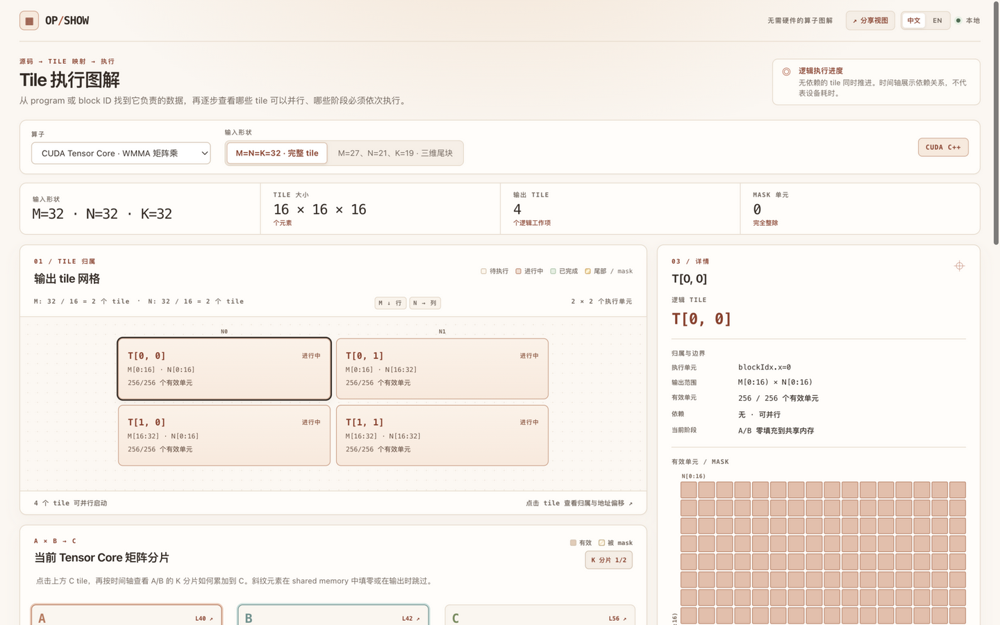
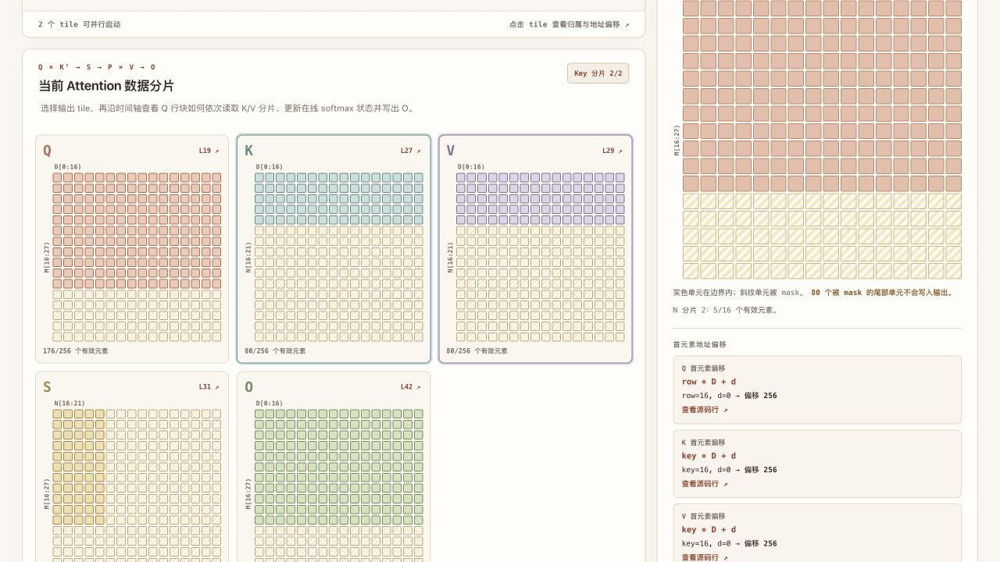
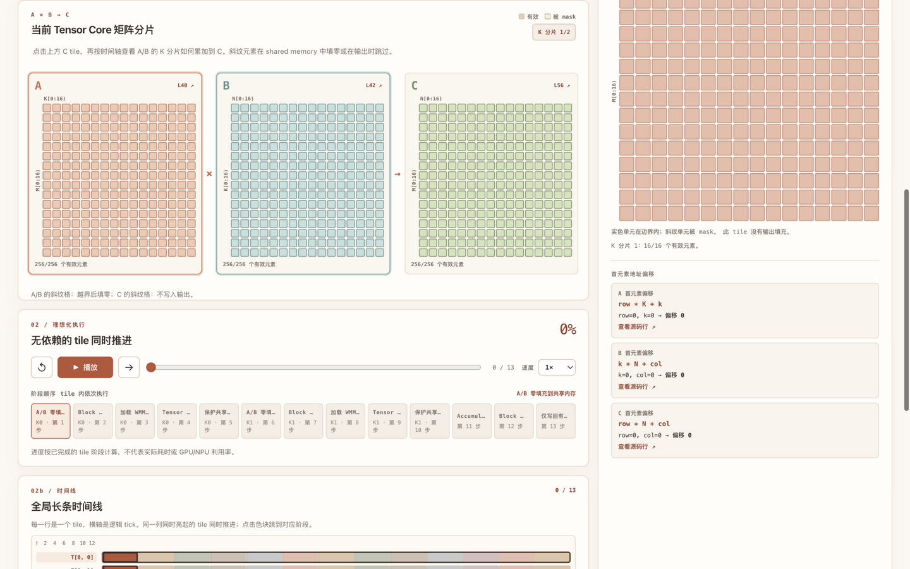

# OP/SHOW

OP/SHOW 是一个本地算子 Tile 图解工具。Agent 对照 CUDA/Triton 源码填写小尺寸 JSON 模型；网页联动展示输出 tile、执行单元、输入矩阵分片、尾部 mask、地址偏移、逻辑阶段及对应源码行。它不执行算子，也不推测设备耗时。

OP/SHOW is a local, hardware-free viewer for source-backed CUDA C++ and Triton tile models. It shows logical data movement and stage order without executing the kernel or estimating device time.



## 示例与截图

| 算子 | 从页面上检查什么 | 示例模型 |
| --- | --- | --- |
| Vector Add | 一维 program 到输出片段的映射与尾部 mask | [Triton-Ascend](examples/triton_ascend_add.json) |
| Reduce | 4 行输出 tile、每 warp 一行、K 分片与输入矩阵 mask | [CUDA Warp Reduce](examples/cuda_warp_reduce.json) |
| GEMV | A 的行/K 分片、x 向量、输出 y 与首元素偏移 | [CUDA Warp GEMV](examples/cuda_warp_gemv.json) |
| GEMM | A × B → C、K 循环、完整和尾部分片 | [CUDA Tensor Core WMMA](examples/cuda_tensor_core_gemm.json)、[CUDA Tiled](examples/cuda_tiled_gemm.json)、[Triton CUDA](examples/triton_cuda_matmul.json) |
| GQA PID 策略对照 | 一个 PID 认领一个 Q 输出任务，或认领一个 KV head 后依次处理多个 Q block；对比 launch 数与串行认领 | [按 Q 分配](examples/triton_gqa_q_owned.json)、[按 KV 分配](examples/triton_gqa_kv_owned.json) |
| FlashAttention-2 风格前向 | Q/K/V、逻辑分数 S、在线 softmax 与输出 O；Q 行和 key 分片的尾块 | [Triton CUDA 教学版](examples/triton_flash_attention2.json) |
| QKV All-to-All | Producer 任务矩阵、PID 认领、peer_mem 路径、Consumer 输出与 Wave | [Triton-Ascend v2](examples/ascend_qkv_alltoall.json) |




Reduce/GEMV 截图使用 `M/ROWS=6、K=37`，选中第二个输出 tile 和第二个 K 分片。FlashAttention 截图使用 `M=27、N=21、D=16`，选中第二个 Q 输出行块和第二个 key 分片；Q/O 有 176/256、K/V 有 80/256、S 有 55/256 个有效单元。颜色与斜纹表示数据位置及 mask，不表示硬件实测结果。

## Contents

- [Quick start](#quick-start)
- [What the viewer shows](#what-the-viewer-shows)
- [Use it with an agent](#use-it-with-an-agent)
- [Install the agent skill](#install-the-agent-skill)
- [CLI](#cli)
- [Model format](#model-format)
- [Limits](#limits)
- [Checks](#checks)
- [Docs](#docs)
- [License](#license)

## Quick start

Python 3.9+ is enough. There are no runtime dependencies and no frontend build step.

```sh
git clone https://github.com/tmchao7/op-show.git
cd op-show
python3 -m op_show serve examples --no-browser
```

Open the printed URL, usually <http://127.0.0.1:8765/>. The operator menu has nine v1 examples (Vector Add, Reduce, GEMV, three GEMMs, FlashAttention-2 forward, and two GQA PID strategies) plus one v2 QKV All-to-All task trace. Each has an aligned case and a tail/padding case.

To check one model without starting the server:

```sh
python3 -m op_show validate examples/cuda_tensor_core_gemm.json
```

Expected output:

```text
Valid source-backed model (cuda): aligned: 4 tiles, 13 steps, padded: 4 tiles, 13 steps
```

If you want the `op-show` command, install the checkout once:

```sh
python3 -m pip install -e .
op-show serve examples --port 8765
```

## What the viewer shows

- **Launch and PID claims first.** The first panel expands the source-backed launch grid into PID lanes and shows which output tasks each PID claims in order. Select a claim to highlight its output tile, input group, source references, and logical stage. Tensor Core GEMM shows one CUDA block per C tile with a serial K loop. The GQA pair makes the tradeoff concrete: 8 Q-owned PIDs each handle one output tile, while 2 KV-owned PIDs each handle four Q output tiles serially for the illustrative 4-Q-head/2-KV-head shape. This is a claim diagram, not a measured performance comparison.
- **Output tile grid.** One card per logical output tile, with its owning worker, bounds, valid/masked cell counts, dependencies, and current stage. The grid is one tab stop; arrow keys move the selection, Home/End jump within a row.
- **Tensor Core GEMM dependencies and slices.** In the WMMA example, full A[M,K], B[K,N], and C[M,N] matrices form a 2×2 dependency map. Select a C tile and advance the K loop: A's row band and B's column band stay tied to that output while their highlighted intersections move. The cell view below shows exact tile masks; solid cells are valid, striped cells are zero-filled or skipped at output.
- **Row/K slices.** For Reduce and GEMV, the selected output row tile determines the X or A matrix rows, current K slice, optional x vector, and Y/y output rows. Stripes show skipped input cells and output rows.
- **Attention slices.** The teaching FlashAttention-2 model follows one Q output row tile across successive K/V key slices. It draws logical Q/K/V/S/O matrices and the online softmax recurrence; S is not a stored global tensor.
- **Logical timeline.** One lane per tile, with one tick per stage slot. Click a segment to seek to that stage. The percentage is completed stages, not elapsed time or utilization.
- **Source evidence.** Cited source lines are marked in the source panel. Click one to see which mapping fields cite it; the reference buttons on the left jump between citations.
- **Share view.** The 分享视图 / Share view button writes the model, scenario, selected tile, logical tick, and language into the URL hash and copies it.



Tensor Core WMMA 的尾块示例可直接检查 `M=27、N=21、K=19`：选中输出 `T[1,1]` 与第二个 K 分片，A/B/C 分别有 33/256、15/256、55/256 个有效单元。斜纹是边界零填充或跳过的元素；这只是源码约束的逻辑视图。

![Tensor Core WMMA GEMM 尾块：选中输出 T[1,1] 和第二个 K 分片](assets/op-show-tensor-core-tail.jpg)

The viewer opens in Chinese and has a 中文 / EN switch in the header. The choice is saved in the browser. Custom models can add the optional Chinese fields described in the [format guide](docs/model-format.md).

## Use it with an agent

The CLI does not call an LLM. The agent reads the kernel and writes the model; the CLI validates and serves it. No API key, GPU, or NPU is involved.

### 1. Keep the checkout in a stable place

```sh
git clone https://github.com/tmchao7/op-show.git ~/tools/op-show
```

The agent needs both the kernel source and this checkout. If you move the checkout later, update the path in your prompt or skill link.

### 2. Give the agent a concrete prompt

Replace the two paths and the example shapes before sending:

```text
Read the kernel at /absolute/path/to/kernel.cu and its launcher.
Use /absolute/path/to/op-show/skills/op-show/SKILL.md.

Build a v1 model with two scenarios:
- aligned: M=32, N=32, K=32
- tail: M=27, N=21, K=19

Use literal source line refs only. If a rule cannot be verified from the source,
set mapping.status to "unknown" and explain what is missing.
Work from /absolute/path/to/op-show, then run:
  python3 -m op_show validate /absolute/path/to/model.json
  python3 -m op_show serve /absolute/path/to/model.json --no-browser
Fix every validation error and give me the local URL.
```

For a task-routing kernel such as QKV All-to-All, ask for v2 only when the `qkv-head-grouped` structure actually fits. Otherwise use v1 or mark the mapping unknown. The [format guide](docs/model-format.md) explains both schemas.

To review an existing model instead of creating one:

```text
Use the op-show skill at /absolute/path/to/op-show/skills/op-show/SKILL.md.
Review /absolute/path/to/model.json against /absolute/path/to/kernel.cu.
Check tile coverage, tail masks, address samples, and every source ref.
Do not edit anything yet; list the mismatches first.
```

### 3. Review the result before trusting it

The validator catches structural mistakes, not a wrong description of the kernel. Check these before you use the walkthrough:

| Look at | What good looks like |
| --- | --- |
| Tile coverage | Every output tile is covered exactly once. In v1, one worker can claim several output tiles in source loop order; in v2, each task has a producer PID and a defined output. |
| Bounds and tails | Ranges end at the real M/N/K; masked counts match the tail cells. |
| Address samples | The formula variables and offsets match the cited source lines. |
| Source refs | Line numbers and code are literal matches, not guessed evidence. |
| Unknown mappings | `status: "unknown"` disables playback and explains what is uncertain. |
| Numbers | Example shapes are labeled as examples; there are no timing or throughput claims. |

Do not let the agent run an untrusted kernel, invent a launch order, or turn a dynamic branch into a definite animation. If the source does not decide a mapping, the correct output is `unknown`.

The portable instructions live in [skills/op-show/SKILL.md](skills/op-show/SKILL.md). Agents without a skill loader can read that file as plain Markdown; give the agent its path in the prompt. They can follow the same steps with the [format guide](docs/model-format.md) and the CLI.

## Install the agent skill

The skill is a folder, not a package:

```text
skills/op-show/SKILL.md
```

It points back to this checkout for `docs/model-format.md`, `examples/`, and the CLI. Keep the checkout around, and **link the skill folder** instead of copying only `SKILL.md`.

### Download

Use either option:

```sh
git clone https://github.com/tmchao7/op-show.git ~/tools/op-show
```

Or open the GitHub page, choose **Code → Download ZIP**, and unzip it somewhere permanent. There is no separate pip package to install for the skill; the checkout is the install.

### Link it into an agent

Use the skills directory your agent scans. Common locations:

```sh
# Claude Code
mkdir -p ~/.claude/skills
ln -s ~/tools/op-show/skills/op-show ~/.claude/skills/op-show

# ZCode and other local agents that scan ~/.agents/skills
mkdir -p ~/.agents/skills
ln -s ~/tools/op-show/skills/op-show ~/.agents/skills/op-show
```

If your agent supports project-level skills, put the same symlink in the project's skills directory instead. On Windows, use a directory junction (`mklink /J`) or keep the complete checkout and point the agent at `skills\op-show`; copying the inner folder alone breaks the relative links to `docs/` and `examples/`.

### Check that it loaded

Start a new agent session and ask:

```text
Use the op-show skill. List the files you will read and the command you will run
before you create a model.
```

A loaded skill should point at `SKILL.md`, the kernel source, `docs/model-format.md`, and `python3 -m op_show validate`. If it cannot find the format guide, the link points at a copy without the checkout.

### Update it

```sh
cd ~/tools/op-show
git pull
```

The symlink keeps working after an update. If you copied the checkout instead, update that copy and keep the link pointed at it.

### If you use a plugin loader

OP/SHOW does not ship a marketplace plugin manifest. The skill folder is the integration point. Use the same clone or ZIP; there is no separate plugin archive. If your agent supports local plugins, use this checkout as the plugin root and register `skills/op-show` as its skill; there is no build step. If your loader requires a manifest, add one that points at this folder. The CLI is still `python3 -m op_show`.

## CLI

| Command | What it does |
| --- | --- |
| `python3 -m op_show validate model.json` | Validate one model and print a one-line summary or `Invalid model: ...`. |
| `python3 -m op_show serve model.json` | Serve one model at `http://127.0.0.1:8765/` and open the browser. |
| `python3 -m op_show serve examples --no-browser` | Serve a directory as an operator menu. |
| `python3 -m op_show serve examples --port 8766` | Use another port. |
| `python3 -m op_show serve model.json --host 127.0.0.1` | Bind explicitly to localhost. |

After `python3 -m pip install -e .`, replace `python3 -m op_show` with `op-show`. `serve` only serves validated models and their local source files, read-only. It does not execute operator code.

## Model format

A model is a JSON file plus a local source path. Start from the closest file under `examples/` and replace its source path, refs, mapping, and two small scenarios.

- **v1** describes output tiles: worker-to-tile mapping, bounds, masks, ordered stages, address samples, and optional GEMM slices. See [cuda_tiled_gemm.json](examples/cuda_tiled_gemm.json) or [cuda_tensor_core_gemm.json](examples/cuda_tensor_core_gemm.json).
- **v2** describes a bounded logical task trace for one fixed `qkv-head-grouped` loop structure: Producer/Consumer PIDs, peer_mem offsets, signal slots, and event dependencies. See [ascend_qkv_alltoall.json](examples/ascend_qkv_alltoall.json) and the schema in [docs/model-format.md](docs/model-format.md). The bundled upstream source keeps its permission notice in [TRITON_DISTRIBUTED_ASCEND_LICENSE](examples/sources/TRITON_DISTRIBUTED_ASCEND_LICENSE).
- **unknown** is the honest option for dynamic or unverifiable mappings. The page keeps the explanation and disables playback.

The validator checks literal source line refs, safe integer formulas, worker-to-tile coverage, bounds, padding, address samples, and dependency cycles. For v2 it also checks task IDs, PID coverage, offsets, signal slots, output coverage, and notify/wait pairing.

## Limits

- The validator is structural. It cannot prove that an arbitrary CUDA or Triton program matches the model.
- The timeline is an ideal logical schedule. It does not model SM/NPU capacity, stalls, latency, block launch order, or measured utilization.
- Example shapes and constants are chosen to exercise full and tail cases; they are not measured hardware values.
- The v2 Producer/Consumer split, group-size rule, wave size, and buffer rules are maintained in Python and must be kept in sync with the source by the model author.
- The bundled CUDA/Triton sources are teaching kernels. The local viewer never compiles or executes them. The optional FlashAttention device test runs only when PyTorch, Triton, and an NVIDIA CUDA device are available.

## Checks

```sh
python3 -m unittest discover -s tests -v
node --check op_show/web/app.js
node --check op_show/web/trace.js
```

The test suite checks model coverage and source evidence. On a CUDA machine, `tests/test_flash_attention_gpu.py` also compares the teaching forward kernel with an independent PyTorch softmax reference for full and tail shapes; it is skipped when the required device or packages are unavailable. The viewer is plain HTML/CSS/JS and has no build step.

## Docs

- [Model format](docs/model-format.md): both schemas and their validation rules.
- [Agent skill](skills/op-show/SKILL.md): the portable workflow an agent should follow.
- [Agent handoff prompt](docs/AGENT_HANDOFF.md): a copyable prompt for a new development session.
- [Visualization research](docs/research-visualization.md): timeline and source-citation references.
- [Matrix UI research](docs/research-ui-matrix.md): table arrangement, color, and accessibility references.
- [Operator ladder research](docs/research-operator-ladder.md): CUDA Reduce/GEMV and Triton FlashAttention-2 sources and scope.

## License

No license file has been added to this repository yet. If you want to use OP/SHOW outside your own machine, ask the maintainer before redistributing it.
